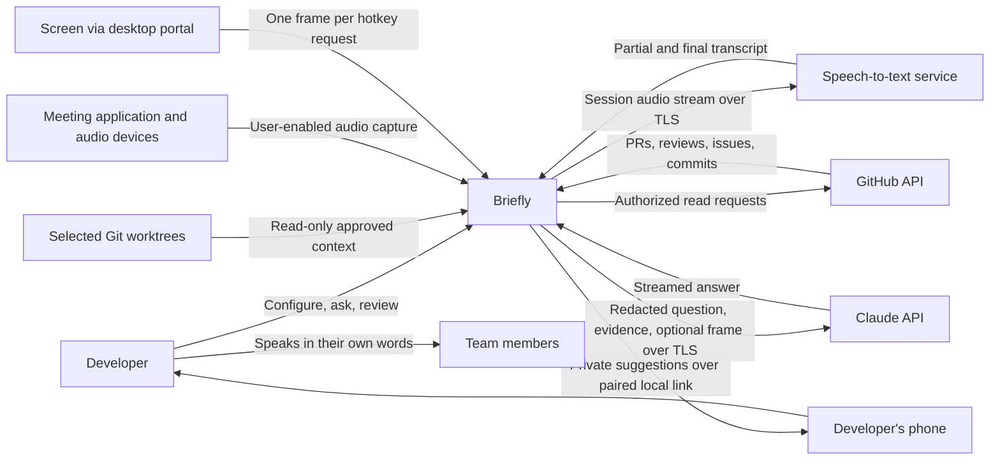
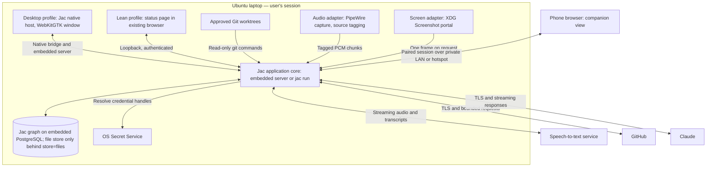
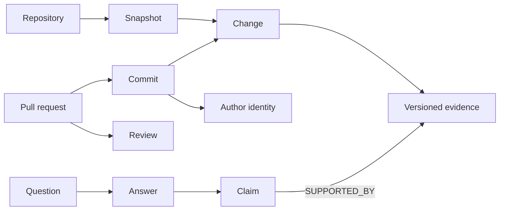
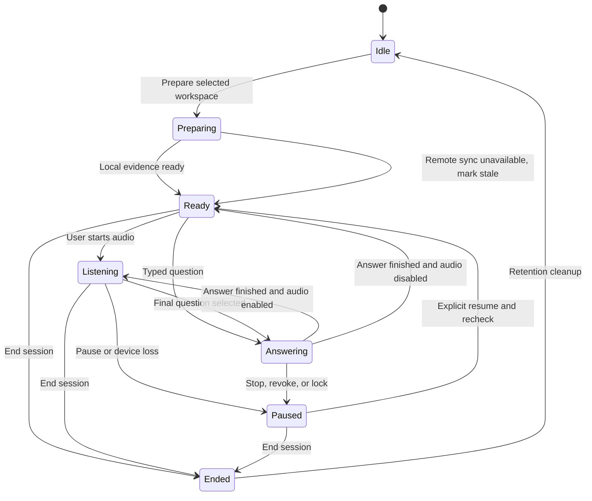
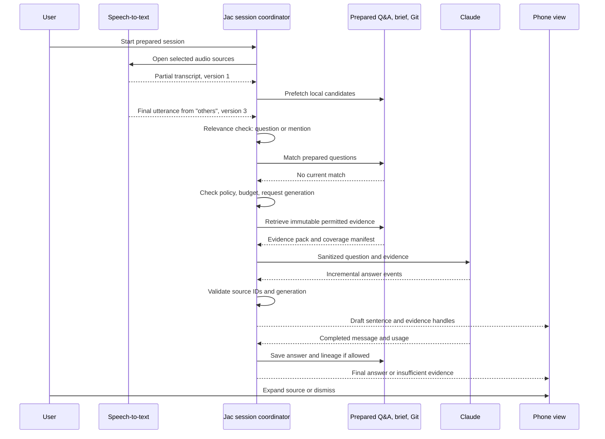

# Briefly — architecture and design

| Document control | Value |
|---|---|
| Version | 0.3.3 — pins Jac 0.39.1 (§3.2). 0.3.2: the clean install runs in a fresh container on GitHub Actions instead of a VM, which does not fit the 4 GB laptop (owner, 2026-11-04). 0.3.1 pinned Jac 0.39.0 as the phase 0 baseline (§3.2). 0.3 added the second purpose: a rigorous evaluation of Jac for desktop apps, with every shortcoming documented |
| Product name | **Briefly**, an AI standup assistant; app identifier `briefly` |
| Date | 2026-11-02 |
| Product owner | Amon |
| Intended audience | Product owner, implementers, reviewers, and pilot users |
| Source idea | `/home/amon/Documents/ideas.md`, idea 2, added 2026-11-01 |
| Implementation status | Design only; no application or feasibility spike implemented |
| Location | `docs/architecture.md` in the Briefly repository; drafted in AfriCinemas and moved here on 2026-11-03 |

## 1. Purpose and architectural direction

Build an Ubuntu assistant that helps a developer explain their actual work during standups, answer follow-up questions, and practise technical explanations. It combines local Git history with GitHub history, listens to other meeting participants when enabled, reads the screen on request, and presents short, evidence-backed suggestions using Claude.

**The project has two purposes of equal weight:**

1. **The product:** a standup assistant the owner actually uses.
2. **The evaluation:** a rigorous, reproducible test of how well the Jac ecosystem builds a real desktop application, documenting every shortcoming and failure found: compiler and runtime defects, missing capabilities, documentation gaps, packaging problems, performance on low-end hardware, and developer-experience friction (§21).

The second purpose sets the **Jac-first rule** (§21.2): wherever Jac offers a way to do something — the native desktop target, graph persistence, walkers, byLLM, the Jac client UI, Jac tests, `jac build` packaging — the app uses it first, measures it, and records what fails. A workaround is added only after the failure is logged, behind a named switch so the Jac path can be re-tested on every compiler release. Avoiding a Jac feature in advance because it might be heavy or immature would hide exactly the findings the project exists to produce.

The recommended architecture is therefore a **native Jac desktop application** (WebKitGTK host, embedded server, graph persistence on the embedded PostgreSQL) as the primary build, plus a **lean profile** of the same codebase served with `jac run` and viewed on a paired phone. The lean profile keeps the product usable in standups if the desktop build does not fit the 4 GB laptop; that outcome is itself a finding. Both profiles use cloud streaming speech-to-text by default, a read-only GitHub connector, and Claude. **Preparation is the main feature:** before the meeting the assistant builds the standup brief and a set of likely follow-up questions with answers, so most live answers come from that cache and the live path only searches the prepared brief and the Git repository.

**The first hardware target is a 4 GB laptop.** The owner's machine reports 3.3 GiB usable RAM with about 0.8 GiB free while only VS Code and a coding assistant are running. The meeting client and IDE take priority; the assistant's target budget is roughly 400–600 MB. Whether the native Jac desktop build (WebKitGTK plus embedded PostgreSQL) fits that budget is an open evaluation question measured in spike S1, not an assumption either way. Local Whisper-class transcription, continuous screen OCR, and a second search index are ruled out as defaults because they are not Jac features and do not fit (§3.1, §6, §13).

**Screen-share privacy is solved by moving the display, not hiding a window.** Ubuntu offers no general way to exclude a window from someone else's full-screen capture (§5.1). The phone companion view sidesteps the problem completely, including full-screen sharing, and moves rendering off the laptop. A separate laptop window under a tested window-share setup remains a secondary mode.

This document uses the concerns covered by [arc42](https://arc42.org/overview/), C4-style context/container views, runtime sequences, measurable quality scenarios, and architecture decision records. These are documentation practices, not a claim of standards certification. The [C4 model](https://c4model.com/diagrams) distinguishes context, container, component, and code views; the first three are sufficient here.

### 1.1 Goals

1. Produce a useful standup brief from verified work since the last standup.
2. Answer questions about implementation, motivation, tests, contribution, risks, and next steps with traceable evidence.
3. Follow what other participants say — questions and mentions of the developer's work — quickly enough to help during conversation.
4. Keep collection, storage, and source selection under the developer's control.
5. Keep suggestions private, primarily by showing them on a paired phone.
6. Keep domain behavior and the UI in Jac, while using existing libraries for OS integration, transcription, and Claude transport.
7. Run alongside a meeting client and IDE on a 4 GB laptop without making either noticeably slower.
8. Produce a reproducible evaluation of Jac for desktop apps: a findings log, canary tests that detect fixes, measured numbers, and a report per compiler release (§21).

### 1.2 Explicit boundaries

- The initial product is single-user and runs on the developer's laptop. No hosted application backend is required.
- Claude inference is remote. “Local-first” means local collection, retrieval, and storage; it does **not** mean source excerpts never leave the device.
- The assistant reads selected projects. It does not edit code, run project tests, execute repository scripts, submit answers, post standups, or change GitHub objects automatically.
- Questions and practice quizzes are supported. The application suggests explanations for the user to assess and say in their own words.
- Audio capture is session-based and visibly indicated. Continuous background recording, hidden meeting bots, and automatic calendar joining are outside the MVP.
- Speech-to-text runs on a cloud streaming service by default on the 4 GB profile, so meeting audio leaves the device. This is an explicit, disclosed setting with a local small-model and a typed-only alternative (§9.3).
- Screen reading is **on demand**: a hotkey captures one frame through the desktop portal and sends it with the question. Continuous capture, local OCR, arbitrary terminal history, clipboard monitoring, editor plugins, remote IDEs, multi-user administration, and cloud synchronization are outside the MVP.
- The unrelated offline utility toolkit in idea 1 is not part of this product.

## 2. Requirements and acceptance traceability

Priority: **P0** is required for a useful personal pilot; **P1** follows the pilot; **R** is research with no delivery promise.

| ID | Requirement | Priority | Design reference | Acceptance evidence |
|---|---|---|---|---|
| FR-01 | Install and run on Ubuntu | P0 | §3, §6, §16 | Clean-machine install, launch, upgrade, and uninstall on each supported image |
| FR-02 | Read branches, commits, staged and unstaged changes | P0 | §7.1 | Fixtures cover worktrees, rebases, renames, deletions, detached HEAD, and untracked files |
| FR-03 | Read current editor context, including approved unsaved buffers | P1 | §7.2 | VS Code active-file/selection/buffer events appear with correct versions and permissions |
| FR-04 | Read GitHub PRs, reviews, issues, and merged work | P0 | §7.3 | Authorized fixtures and an opt-in live repository exercise pagination, revocation, and offline cache |
| FR-05 | Generate a standup brief and explain contributions | P0 | §8, §12 | Every factual work claim has evidence; authorship and merge status are correctly distinguished |
| FR-05a | Prepare likely follow-up questions with grounded answers before the meeting | P0 | §10.4 | A prepared answer is served from cache when a live question matches it; stale entries are invalidated by new evidence |
| FR-06 | Answer typed questions and generate practice quizzes | P0 | §10, §12 | Correct answers and explanations cite relevant code or clearly state insufficient evidence |
| FR-07 | Listen to other participants and suggest answers to questions and mentions of the developer's work | P0 | §9 | Speaker side known from audio source; automatic question/mention detection on by default; correction and latency gates pass |
| FR-08 | Private suggestions on a paired phone companion view | P0 | §5.6 | Suggestions appear only on the paired device; laptop shows no content in companion mode, so any screen-share mode is safe |
| FR-08a | Native desktop window on the laptop; private only while sharing a tested window/tab or other display | P0 | §5, §21.3 | Remote receiver recording contains zero assistant pixels or content in the supported workflow |
| FR-09 | Overlay excluded from arbitrary full-screen capture on the same monitor | R | §5.5 | Superseded in practice by FR-08; remains unsupported on the laptop screen |
| FR-15 | Read the screen on request and include it in an answer | P0 | §9.4 | Hotkey capture through the portal, explicit per-session permission, one frame per request, nothing retained by default |
| FR-10 | Use Claude for generative reasoning | P0 | §10 | Provider identity/model recorded; no silent substitution with another provider |
| FR-11 | Build the product core and UI in Jac, Jac-first for every concern | P0 | §6, §21.2 | Buildable Jac project; every non-Jac line is justified by a finding ID or a documented OS/SDK boundary |
| FR-16 | Build, install, and run as a native Jac desktop app on Ubuntu | P0 | §6, §16.3, §21 | `jac build` desktop artifact installs and runs on a clean machine; every deviation is a finding |
| FR-17 | Lean profile from the same codebase (`jac run` + phone) | P0 | §6.1 | Same core and UI components; differences limited to host and display wiring |
| EV-01 | Findings log with reproducible entries | P0 | §21.4 | Every entry has version, repro (kept outside the repo), status, workaround, and canary test where testable |
| EV-02 | Canary tests that detect upstream fixes and regressions | P0 | §21.5 | Run on every compiler upgrade; a passing canary flips the finding to "fixed in X" |
| EV-03 | Measured evaluation numbers per compiler release | P0 | §21.6 | Memory, startup, build, package, and DX metrics recorded with the same protocol each time |
| EV-04 | Evaluation report | P0 | §21.7 | Report per phase and per compiler upgrade, plus a final report |
| FR-12 | Explain source freshness, uncertainty, and attribution | P0 | §8, §12 | Stale, contradictory, incomplete, and missing evidence cases have explicit UI states |
| FR-13 | Export approved notes as Markdown | P0 | §12 | User chooses destination and content; export contains citations and status labels |
| FR-14 | Editor integrations and semantic retrieval | P1 | §7, §17 | Each capability has an independent permission and validation gate |
| NFR-01 | Fast interaction and bounded resource use on a 4 GB laptop | P0 | §13 | Assistant stays within its memory budget while a meeting client and IDE run; no swapping-induced meeting stutter |
| NFR-04 | Predictable running cost | P0 | §10.6 | Per-standup cost estimate shown before the session; actual usage reconciled after it |
| NFR-02 | Minimize sensitive-data exposure | P0 | §14 | Secret, scope, IPC, retention, and prompt-injection tests pass |
| NFR-03 | Useful behavior during dependency failures | P0 | §15 | Offline and fault-injection tests preserve notes, provenance, and UI responsiveness |

The requested private overlay is split into FR-08 (phone, primary), FR-08a (laptop window under a tested share), and FR-09 (same-screen exclusion, unsupported) rather than claiming to have solved the full-screen case.

## 3. Assumptions, constraints, and platform scope

### 3.1 Starting assumptions

| Topic | Proposed default | Effect if different |
|---|---|---|
| Primary OS | Ubuntu 24.04 LTS, GNOME, Wayland, x86-64 | Other desktop/compositor combinations require their own capture and shortcut tests |
| Additional OS qualification | Ubuntu 26.04 LTS; Xorg where available | Support is declared only after the matrix passes |
| Hardware | **4 GB RAM class** (owner's laptop: 3.3 GiB usable, ~0.8 GiB free with VS Code open), SSD, no GPU | Machines with 8 GB+ may enable the local speech model |
| Evaluation machines | The owner's 4 GB laptop (low-end profile), plus a clean Ubuntu VM for install tests; an 8 GB+ VM for comparison numbers if available | Without a second profile, the report states that numbers come from one low-end machine only |
| Jac version | Pinned per phase; every new release is re-evaluated (§21.5) | Unpinned upgrades would make findings irreproducible |
| Companion device | Owner's phone with a current mobile browser, on the same private network or the phone's hotspot | Without a phone, fall back to the laptop window under a tested window share (FR-08a) |
| Speech-to-text | Cloud streaming service chosen in spike S3, user-supplied key | Local small model or typed-only mode if cloud audio is not allowed |
| First editor | None in the MVP; Git provides the change context | VS Code bridge is P1 |
| Project size | Up to three selected repositories, a few thousand tracked files each | Larger workspaces need a persistent search index (deferred, §8.3) |
| Language | English initially, including varied accents and technical vocabulary | Additional languages and code-switching require separate speech evaluations |
| Meeting clients | Google Meet in a tested browser and Zoom's Linux client | Teams/browser variants are a later qualification target |
| Account | User supplies a Claude API key and read-only GitHub authorization | Organization restrictions may prevent cloud use or repository access |
| Network | Internet during Claude use, with cached local fallback | Offline operation cannot generate new Claude responses |

These are design choices to validate with the owner, not observations about their hardware or installed meeting tools. Ubuntu support commitments should follow Canonical's [release lifecycle](https://ubuntu.com/about/release-cycle), and release notes must list exact tested OS, GNOME, browser, and client versions.

### 3.2 Jac baseline and local evidence

The architecture was drafted against **Jac 0.38.3** and its bundled `jac-essentials`, `jac-project-kinds`, `jac-desktop-app`, and `jac-by-llm` guides. On 2026-11-03, before any code was written, the compiler was upgraded to **Jac 0.39.0** (released 2026-11-02), which is the pinned version for phase 0. The upgrade is recorded as the evaluation baseline. Changes in 0.39.0 that affect this design:

- **Inline Python (`::py::`) is removed** ([#10475](https://github.com/jaseci-labs/jaseci/pull/10475)). OS/SDK adapters (§6.3) are written as `.py` modules imported from Jac.
- **JacPython** ([#10299](https://github.com/jaseci-labs/jaseci/pull/10299)) replaces CPython's C with a Jac port and reports about 1.4× (pyperformance) to 1.9× (microbenchmarks) slowdown against stock CPython. The binary's embedded runtime reports CPython 3.14.6 (`cpython-314` ABI). Spike S0 must establish whether server code runs on JacPython, and S1 must confirm that the C-extension packages the adapters need install and load on this ABI.
- Fixes to stale prepared/compiled records ([#10425](https://github.com/jaseci-labs/jaseci/pull/10425), [#10426](https://github.com/jaseci-labs/jaseci/pull/10426)) may resolve the stale prepared cache note in §21.3; re-test it in S0.

On 2026-11-05, between spikes S1a and S4, the pin moved to **Jac 0.39.1** (released 2026-11-04; the owner chose to upgrade before S4). The upgrade and what it changed are in `docs/jac-findings/reports/release-0.39.1.md`.

Relevant findings:

- A Jac desktop target supports a native WebKitGTK host on Linux and an embedded server codespace. The UI is compiled to JavaScript/React DOM.
- The embedded desktop runtime also starts its own PostgreSQL cluster. Native desktop therefore does not mean a single lightweight process with no database overhead.
- Graph persistence is PostgreSQL at every scale (SQLite graph storage was retired in jaclang 0.36). Locally the runtime boots an embedded PostgreSQL **lazily, on first graph use**. **Consequence:** under the Jac-first rule, the app stores its data in the graph in both profiles, so PostgreSQL runs in both. Spike S1 measures its memory on the 4 GB laptop. If it does not fit, that is logged as a finding and the lean profile switches to a small file store behind the `store=files` switch (§6.4), keeping the graph path re-testable.
- The documented window SDK provides title, size, fullscreen, and termination controls. It does not document capture exclusion, always-on-top, click-through, or multiple-window management.
- byLLM supports streamed string generation. That alone does not establish streaming through the application server and desktop UI.
- The guide describes platform installer/signing work as incomplete. Distribution packaging must be owned and tested by this project.
- Existing AfriCinemas reports are historical inputs to the evaluation: [response serialization](https://github.com/dennisovich254/africinemas/blob/main/docs/jac-issues/JI-033-raw-binary-responses-are-serialized-as-text.md), [WebSocket targeting](https://github.com/dennisovich254/africinemas/blob/main/docs/jac-issues/JI-054-websocket-no-targeted-delivery.md), [desktop client build needs sudo](https://github.com/dennisovich254/africinemas/blob/main/docs/jac-issues/JI-005-desktop-client-build-needs-sudo.md), [bundled bun requires AVX2](https://github.com/dennisovich254/africinemas/blob/main/docs/jac-issues/JI-002-bundled-bun-requires-avx2.md), [scaffold templates not lint-clean](https://github.com/dennisovich254/africinemas/blob/main/docs/jac-issues/JI-009-scaffold-templates-not-lint-clean.md), [mobile app pins React 18](https://github.com/dennisovich254/africinemas/blob/main/docs/jac-issues/JI-019-mobile-app-pins-react-18-for-whole-workspace.md), and [a function named `take` breaks sealing](https://github.com/dennisovich254/africinemas/blob/main/docs/jac-issues/JI-045-function-named-take-breaks-seal.md). Reproduce each on the pinned compiler before assuming it still applies; those that still apply become canaries (§21.5).

Do not copy AfriCinemas' remote-backend desktop configuration, business data, credentials, or application authentication into this product. Briefly needs its own application identifier (`briefly`), local state, and permissions.

## 4. System context and trust boundaries

### 4.1 Context view



Team members do not connect to the assistant. The assistant does not join or modify the meeting. The meeting application retains ownership of screen sharing and its own capture selection.

### 4.2 Boundaries

| Boundary | Data crossing it | Enforcement |
|---|---|---|
| Workspace → collector | Code, diffs, metadata | Approved canonical roots, exclusion policy, file limits, no code execution |
| Audio system → speech-to-text | Selected PCM streams, tagged by source | Session permission, device identity, bounded memory queues; cloud egress only when the cloud speech setting is on |
| Screen → application | One captured frame per request | Portal permission, explicit hotkey, preview before send, no retention by default |
| Local core → companion device | Answer/evidence view models | One-time QR pairing, per-session token, private network or phone hotspot, laptop bound only while a session runs |
| Local core → Claude | Sanitized question and retrieved evidence | Repository cloud policy, token limit, secret filter, preview, provider adapter |
| Local core → GitHub | Repository-scoped queries | Read-only credential and endpoint allowlist |
| Local core → renderer | Minimal answer/evidence view models | Authenticated session, escaped rendering, no credential exposure |
| Assistant display → screen capture | Potentially all visible pixels | Tested sharing scope; no universal OS exclusion assumption |

## 5. Private overlay: supported contract and limits

### 5.1 Evidence and consequence

The XDG ScreenCast portal documents monitor, window, and virtual-monitor sources. Its public API does not provide a general per-window “never include me in anyone else's capture” switch. Electron's similarly named `setContentProtection` API is documented for macOS and Windows, not Linux. **The architectural inference is that changing to Electron does not establish Ubuntu capture exclusion.** See the [ScreenCast portal](https://flatpak.github.io/xdg-desktop-portal/docs/doc-org.freedesktop.portal.ScreenCast.html) and [Electron window documentation](https://www.electronjs.org/docs/latest/api/browser-window).

An always-on-top window, click-through surface, transparency, or absence from a task switcher does not prove exclusion from a capture stream. Neither does successfully hiding the overlay in the user's local meeting preview.

### 5.2 Privacy modes

| Mode | User workflow | Product claim |
|---|---|---|
| **Phone companion (default)** | Suggestions appear on the paired phone; the laptop shows only a status page with no content | Private under any laptop sharing mode, including full screen (§5.6) |
| Window/tab share | Share only the approved editor window or browser tab; assistant remains a separate browser window | Private only for the exact tested capture implementation and scope |
| Unshared physical display | Share display A; assistant stays on display B | Private while B remains excluded and displays are not mirrored |
| Same-monitor full-screen share without phone | Assistant would appear within the captured desktop | Unsupported; laptop content is concealed |
| Unknown or changed sharing setup | Scope is not established, or the user changes it | Laptop content concealed until the user rechecks the setup; phone unaffected |

A browser tab cannot show a local IDE, so tab sharing is useful only when the presentation itself is in that tab. A same-monitor window-share workflow still requires tests for occlusion, popups, application grouping, and capture fallback.

### 5.3 User-facing behavior

The rules below apply to the laptop window modes (FR-08a). In phone companion mode the laptop shows no answer or transcript content, so the preflight is not needed.

Use a compact **separate top-level window**, never an assistant panel inside the editor window being shared. Expose collapse, enlarge, move, pause listening, and conceal controls. In the MVP this is a separate browser window opened on the laptop status page's meeting route.

Before showing private content during a meeting:

1. Select the intended capture mode and target.
2. Display a conspicuous test card containing a random phrase.
3. Verify from another participant device or receiver-side recording that it is absent.
4. Record the tested configuration and the user's acknowledgment.
5. Replace the card with suggestions and label the status **“Window-share setup checked”**, not “Invisible.”

The application does not have automatic access to another meeting client's ScreenCast session. Some changes can be observed locally, such as a display disconnect; others, such as switching from window to entire-screen sharing, may be invisible to it. The product must state that limitation. Preflight is a workflow check, not continuous technical proof.

On an observed display/compositor change, lock, suspend, lost heartbeat, or explicit sharing-mode change, clear sensitive surfaces and require a new check. Never move a visible private window onto the remaining monitor after a hot-unplug. Clear before repositioning when the host allows it. A race can still expose frames; hot-unplug privacy is a release-blocking test for the second-display mode.

Provide a configurable conceal shortcut and a distinct **Stop session** action. Conceal blanks answer/transcript content; Stop also closes audio streams, cancels generation, and clears volatile buffers. App notifications never contain questions, source excerpts, or answers.

Global shortcuts should use the [XDG GlobalShortcuts portal](https://flatpak.github.io/xdg-desktop-portal/docs/doc-org.freedesktop.portal.GlobalShortcuts.html) where implemented. Capability-probe the actual backend, report the binding returned by it, and handle denial or conflicts. A focused-window button remains available, but cannot be advertised as an equivalent global emergency shortcut.

### 5.4 Qualification matrix

For every proposed supported combination, record exact versions and test:

- GNOME Wayland and separately Xorg, if offered by that Ubuntu image.
- Meet in the selected Chromium-based browser; Zoom Linux native; Firefox/Teams only when explicitly qualified.
- Individual window, browser tab where applicable, monitor, and multi-monitor sharing.
- Overlay overlap, minimization, menus, evidence drawer, dialogs, Alt-Tab, workspace switch, screen lock, notifications, screen scaling, and fractional DPI.
- Share stop/start, window-to-screen changes, monitor removal, mirroring, crash, and app recovery.

Use an actual remote receiver and saved receiver-side frames. A local OBS capture is supplemental because its capture path may differ from the meeting client's. Zero assistant pixels and zero assistant text in supported recordings is the release criterion. Whole-screen sharing should be a negative test showing why it is unsupported.

### 5.5 Research gate for stronger exclusion

Investigate compositor-supported capture filtering or a controlled presentation output only if FR-09 is essential. A GNOME extension would be compositor/version-specific, privileged in the desktop session, and maintenance-heavy. A virtual camera or custom stream excludes an overlay only from that particular output; it does not protect arbitrary full-desktop sharing. No such approach enters the supported architecture without a demonstrated receiver-side result and an explicit support boundary. With the phone companion as default, FR-09 is not expected to be needed.

### 5.6 Phone companion view

The Jac server serves a phone-sized UI route. The phone is a display and a small remote control (pause, conceal, "Answer this", capture screen, next/previous answer); it holds no credentials and no repository data beyond the answers on screen.

**Network.** Use the home/office private network, or turn on the phone's hotspot and join the laptop to it. The hotspot keeps traffic on a two-device network the developer controls, and is the recommended setting on shared or public Wi-Fi. The server listens on the LAN interface **only while a session is active**; otherwise it is loopback-only.

**Pairing.**

1. The laptop shows a QR code containing the LAN URL and a one-time pairing code (short expiry).
2. The phone exchanges the code for a per-session token, stored in the page's memory only.
3. The server accepts exactly one paired device per session and rejects all other clients. A second pairing requires the developer to approve it on the laptop.
4. Ending the session revokes the token and closes the LAN listener.

**Transport security.** Plain HTTP on a shared network exposes answers to anyone sniffing it. The MVP therefore permits plain HTTP only on the phone hotspot or a network the user marks as private; on other networks it requires HTTPS with a per-install self-signed certificate whose fingerprint the phone confirms during pairing. Spike S7 checks how the phone browser handles that certificate. If it is too awkward, hotspot-only is the supported rule.

**Behavior.** Keep the phone screen awake during a session. Large type, one answer at a time, swipe for previous answers, and a visible listening indicator. If the phone disconnects, the laptop stays concealed and does not fall back to showing content on its own screen.

## 6. Building blocks and Jac implementation strategy

### 6.1 Container and deployment view

“Container” below means a C4 runtime/data-store unit, not a Docker container.



**Two run profiles, one codebase.** The core, UI components, and graph model are shared; only the host and display wiring differ.

| Profile | How it runs | Laptop display | Role |
|---|---|---|---|
| **Desktop** (primary) | `jac build` native desktop artifact: WebKitGTK host, embedded server, embedded PostgreSQL | Native window, plus phone companion | The evaluation target and the intended product |
| **Lean** (fallback) | `jac run` local server | Tab in the existing browser, plus phone companion | Keeps the product usable if the desktop profile fails the memory budget or a blocking finding is open |

The phone companion works in both. No local speech model and no search index service run by default. The local speech model, when chosen (§9.3), runs as a supervised child process started only for the session. Every difference between the profiles that is forced by a Jac limitation is recorded as a finding.

### 6.2 Component responsibilities

| Component | Responsibilities | Key boundary |
|---|---|---|
| Workspace manager | Root approval, repo/worktree identity, exclusions, cloud policy | Never interpret a source path as permission |
| Git collector | Stable snapshots of commits, index, working tree, and branch state | Reads only; no checkout, fetch, hooks, or external diff execution |
| GitHub connector | Scoped synchronization at preparation and attribution metadata | No mutations; no model-chosen URLs |
| Evidence store | Prepared brief, prepared Q&A, evidence excerpts with commit SHA and hashes | Jac graph nodes and edges; canonical record of what an answer used |
| Retrieval service | Prepared Q&A match, brief search, `git grep`/`git log` at question time | Filters by repository policy before searching |
| Preparation service | Builds the brief and likely follow-up Q&A before the meeting | Runs outside the live path; invalidates on new commits |
| Session coordinator | Preparation, listening, requests, cancellation, budgets | Owns active session and generation identifiers |
| Audio adapter | Device selection, source tagging (others vs me), chunking to speech-to-text | Mic and meeting output kept as separate streams |
| Speech-to-text adapter | Cloud streaming client by default; local small model optional | Only component that sends audio off the device |
| Relevance detector | Question and mention detection on other participants' final utterances | Cheap local rules first; Claude only for passing utterances |
| Screen capture adapter | One frame via portal on hotkey, downscale, preview | No continuous capture; nothing retained by default |
| Claude adapter | Model configuration, request building, streaming, usage | Only component allowed to call Claude |
| Answer assembler | Claim/evidence IDs, status, attribution, display validation | No ungrounded output presented as verified |
| Companion server | Phone pairing, session token, phone-sized UI | Single paired device; LAN listener only during a session |
| Privacy controller | Display mode, conceal, preflight for laptop-window modes | Independent of model responsiveness |
| IDE bridge (P1) | Active file, selection, optional unsaved text | Not in the MVP |

### 6.3 Language and dependency policy

Author UI components, domain models, collectors, retrieval, orchestration, permission policy, and provider adapters in `.jac`. Jac server-code interoperability may call mature Python libraries at OS/SDK boundaries: the chosen speech-to-text SDK, PipeWire/D-Bus portal bindings, and the Secret Service client. Anthropic's SDK is used only where a byLLM finding requires it (§10.1).

The P1 VS Code extension can be a small TypeScript package because that is the editor's extension boundary. These are infrastructure adapters, with typed contracts and no duplicated product rules. “Built in Jac” does not require reimplementing a speech engine, browser, or Git in Jac.

Apply the **Jac-first rule** (§21.2): use the native Jac desktop target, graph persistence, walkers, the Jac client UI, byLLM, and Jac's test runner first. A non-Jac library or tool is allowed only (a) at a true OS/SDK boundary that Jac does not claim to cover (PipeWire, D-Bus portals, the speech-to-text SDK, the Secret Service), or (b) after a finding shows the Jac way fails, in which case the finding ID is cited in a comment at the workaround and the Jac path stays behind a switch. Track the share of non-Jac code per phase (§21.6).

Do not introduce Electron, Tauri, Kubernetes, Redis, a vector database service, or a hosted worker fleet into the product. A tiny reference app in another stack may be built **outside the repository** purely to put Jac's numbers in context (§21.6).

### 6.4 Persistence decision

Use **one store: the Jac graph**, persisted by the runtime. It holds repository registrations, settings, permissions, the prepared brief, prepared Q&A, saved answers, sessions, and the evidence excerpts they cite, as nodes and edges reached by walkers. This exercises Jac's core data model, schema evolution, and the embedded PostgreSQL in a desktop setting.

If spike S1 shows PostgreSQL does not fit the lean profile's memory budget, or a persistence defect blocks use (AfriCinemas' JI-042 is a known input), log it and switch the lean profile to a per-user directory of JSON files behind `store=files`. The switch sits behind a small storage interface used only for that reason; the desktop profile keeps the graph so the defect stays observable.

The Git repository itself is the searchable source. At question time, retrieval runs fixed read-only `git grep`, `git log`, and `git show` commands against the commits named in the brief. For a few small repositories this stays well under the retrieval budget without a separate index.

An evidence excerpt is saved with repository ID, commit SHA, path, line range, and content hash, so a citation remains resolvable after the working tree changes. Add a full-text index only if measured retrieval latency or recall fails on real repositories.

### 6.5 Proposed standalone layout

```text
briefly/
  AGENTS.md
  jac.toml
  main.jac
  ui/                 # onboarding, preparation, laptop status page, settings
  ui/companion/       # phone view and pairing
  core/
    workspace/        # scope, identity, policy
    collectors/       # git, github
    evidence/         # excerpts, prepared brief and Q&A files
    retrieval/        # prepared-answer match, brief search, git grep/log
    sessions/         # state machine, requests, budgets
    ai/               # Claude adapter, prompts, validation, preparation
    audio/            # capture, source tagging, speech-to-text adapters
    relevance/        # question and mention detection
    screen/           # portal capture and preview
    privacy/          # display mode, conceal, pairing policy
    observability/    # redacted local metrics, cost tracking
  hosts/desktop/      # desktop profile wiring
  hosts/lean/         # lean profile wiring
  tests/              # unit, contract, integration, evaluations
  tests/canaries/     # one test per open Jac finding (§21.5)
  bench/              # evaluation measurement scripts and saved results (§21.6)
  packaging/ubuntu/
  docs/jac-findings/  # JD-NNN entries, index, and per-release reports (§21.4, §21.7)
  docs/adr/
  docs/runbooks/
```

This is a proposed layout, not files already scaffolded. Compiler pins and dependency locks belong to the new repository, independently of AfriCinemas.

## 7. Context collection

### 7.1 Local Git and filesystem

On approval, resolve the repository root and Git common directory, identify its worktree, and assign stable internal IDs. Treat separate worktrees as separate working contexts even when they share commits. Multiple GitHub remotes require an explicit association; never guess that the first remote is the user's canonical repository.

Capture:

- HEAD SHA, branch or detached-HEAD status, upstream reference if present, and merge/rebase state.
- Recent commits, parent SHAs, author and committer identities, messages, and affected paths.
- Two change layers in the MVP: `HEAD → index` and `index → saved files`. The third layer, `saved file → approved unsaved buffer`, arrives with the P1 editor bridge.
- Eligible untracked files after explicit inclusion; ignored files remain excluded unless separately approved.
- Relevant project docs, tests, build manifests, and change-linked symbols as source text.

Use structured Git subprocess argument arrays with fixed read-only commands, `--` path separation, NUL-delimited output where available, bounded output/time, and optional-lock suppression. Disable external diff/text-conversion helpers and filesystem-monitor hooks for collection. Never run a repository's scripts, hooks, build, language server, or test suite merely to understand it. An uploaded or discovered test report is evidence of that report, not permission to rerun it.

A snapshot is immutable. Record HEAD before and after collection, file content hashes, index state, and editor document versions. Retry if they change; after bounded retries, mark the snapshot incomplete instead of presenting mixed state as atomic. Read eligible file bytes once per captured version. Detect path/symlink escapes before reading, revalidate file identity, and use safe relative opens where possible to reduce races.

The MVP does not run filesystem watchers. It reads Git state at preparation and again when a question needs it; a cheap `HEAD`/index check before each live answer detects changes since preparation and marks affected prepared answers stale. Exclude dependencies, build outputs, `.git` internals except required metadata, large binaries, and user-denied paths. Start with a 1 MiB per-text-file limit and explicit overrides; record skipped/truncated sources.

Never infer that an uncommitted line was authored by the current user. Distinguish “present in this worktree” from “my committed contribution.”

### 7.2 Editor integration (P1)

Not part of the MVP: for standups, Git already records what changed, and the bridge adds a pairing protocol, a TypeScript package, and unsaved-buffer privacy decisions. The design below applies when it is added.

The VS Code bridge sends workspace identity, active document URI, language ID, selection, document version, and optional bounded unsaved text. Diagnostics may be included with their origin and timestamp. Use editor events rather than screen OCR. VS Code exposes [active-editor and text-document change events](https://code.visualstudio.com/api/references/vscode-api).

Unsaved-buffer access is a separate opt-in. An excluded file remains excluded even if active in the editor. Selection changes update retrieval hints; they do not trigger an AI call on every cursor movement. Buffer content is volatile by default and expires at session end. Source versions used by a saved answer are retained only if the user also allows that source to be persisted.

Pair the extension using a short-lived one-time code and issue a scoped credential for that approved workspace. Sequence events per document; reject old versions. If the extension disconnects, label editor state stale and continue from saved files.

Initial support is local `file:` workspaces. Remote SSH, WSL, dev containers, and virtual workspaces need an agent on the correct side of the boundary and independent authorization. Do not assume a document URI maps to a local path; see VS Code's [virtual workspace guidance](https://code.visualstudio.com/api/extension-guides/virtual-workspaces).

### 7.3 GitHub integration

For a personal pilot, accept a fine-grained token restricted to selected repositories and store it in the OS keyring. Request read access to contents, pull requests, and issues; enable checks/actions read access only when CI evidence is enabled. Required metadata access and each endpoint's exact permissions must be verified against [GitHub's fine-grained permission reference](https://docs.github.com/en/rest/authentication/permissions-required-for-fine-grained-personal-access-tokens). Expiry, organization approval, and repository access failures need actionable status.

A distributed product can later use a GitHub App and documented user authorization. Never ship a GitHub App private key or OAuth client secret in the desktop binary. Any eventual token broker is a new service and trust boundary requiring an ADR.

Synchronization includes:

- PR metadata, state, base/head SHA, merge SHA/time, descriptions, changed files, and commit links.
- Review decisions, review comments, issue comments, and linked issues.
- Optional CI/check conclusions tied to the exact commit SHA and execution time.
- Author, reviewer, assignee, merger, and co-author relationships as different roles.

Use a serial API queue, pagination, authenticated conditional requests, endpoint cursors, and jittered backoff. A selected-repository refresh at session preparation is followed by low-frequency background polling, initially every five minutes, with a manual refresh. Webhooks are preferable when a reachable receiver exists, but the MVP deliberately avoids a public inbound server. Honor rate-limit/reset and retry headers. This follows [GitHub REST best practices](https://docs.github.com/en/rest/using-the-rest-api/best-practices-for-using-the-rest-api).

Record `source_updated_at`, `fetched_at`, ETag, pagination completion, and any endpoint limits. For example, GitHub's [PR file listing](https://docs.github.com/en/rest/pulls/pulls) has a documented maximum result size; a successful HTTP response is not proof of complete context. Missing patches, large diffs, unavailable commits, force pushes, and deleted PRs produce coverage warnings.

Read local objects when they exist and match the exact SHA. Do not auto-fetch into the user's repository. If additional objects are needed, a later explicit managed mirror can be isolated from their working tree. Revoked authorization stops synchronization and cloud use of affected cached evidence; the UI offers local cache removal.

## 8. Evidence model, retrieval, and contribution attribution

### 8.1 Logical model

| Entity | Required fields and role |
|---|---|
| Workspace | ID, approved roots, repository IDs, collection/cloud policy version |
| Repository / Worktree | Local identity, GitHub identity if confirmed, branch/HEAD observations |
| PersonIdentity | Confirmed GitHub user ID, Git identities, owner-confirmed aliases |
| Snapshot | ID, repo/worktree ID, HEAD/index/buffer versions, captured time, completeness |
| Evidence | ID/version, kind, source URI, immutable text/hash, source/fetch time, classification, retention |
| Commit / PR / Review / Issue / TestResult | Source-native identifiers and relevant lifecycle metadata |
| Change | Before/after evidence references, change layer, file/symbol mapping |
| Session | ID, selected workspace, reporting window/timezone, privacy mode, state, budget |
| TranscriptSegment | Stream ID, sequence, monotonic times, text version, partial/final state |
| Question | ID, session ID, origin, transcript version or typed text, generation ID |
| Answer / Claim | Content, evidence IDs, support status, model/prompt version, completion status |
| Consent / AuditEvent | Scope, action, policy version, timestamp, redacted outcome |

These are Jac `node` archetypes in the persisted graph (§6.4). Relationships are typed `edge` archetypes: `CONTAINS`, `CHANGES`, `AUTHORED_BY`, `REVIEWED_BY`, `ASSOCIATED_WITH_PR`, `ADDRESSES_ISSUE`, `VERIFIED_AT_SHA`, `DERIVED_FROM`, and `SUPPORTED_BY`. Retrieval expansion (§8.3 step 5) is a walker over these edges. Schema changes during development exercise Jac's persistence migration and are a deliberate source of findings.



### 8.2 Invariants

1. Evidence identity includes repository, source identity, and version; a filename alone is not an ID.
2. A local citation resolves to captured bytes and line ranges, not whatever now occupies that path.
3. A remote code citation includes a full commit SHA when possible. PR comments retain their URL and cached version.
4. Every answer records its evidence set, snapshot versions, prompt/model version, and source freshness.
5. An answer cannot cite evidence from a denied repository or expired permission scope.
6. Derived summaries and search rows carry lineage so policy changes and deletion propagate.
7. Deleted evidence leaves a non-sensitive unavailable marker if a retained answer references it; do not silently substitute new code.
8. No model-generated self-confidence percentage is treated as evidence quality.

### 8.3 Retrieval pipeline

1. Check the prepared Q&A first. If the question matches a prepared question whose evidence is still current, show that answer immediately and skip Claude.
2. Resolve the selected repositories and time window.
3. Apply collection, retention, and cloud-sharing policy before search.
4. Search the prepared brief, then run `git grep` for exact symbols, paths, and terms and `git log --grep` for PR/issue numbers, limited to the brief's commits and changed files.
5. Expand a bounded number of relationships from the brief: change → commit → PR → review → tests.
6. Rank by direct question match, source authority for that question, recency, and version consistency.
7. Deduplicate, diversify across necessary evidence types, redact again, and assemble a token-bounded pack.
8. Attach an evidence manifest and coverage notes before calling Claude.

Start with Git search and explicit relationships. Add a local embedding model only if held-out evaluations show a meaningful recall gap. Embeddings do not replace permission filtering, exact symbol retrieval, or immutable citations. They are also sensitive derived data requiring deletion.

Default live evidence budget: 6,000 tokens within a 12,000-token total input cap. Prefer complete relevant hunks over arbitrary truncated fragments. An optional deeper explanation can use a larger approved budget outside the live fast path. Never send the whole repository by default.

### 8.4 Truth and contribution rules

- Separate **authored**, **co-authored**, **reviewed**, **merged by**, **assigned to**, and **present in local worktree**.
- Confirm the user's identity aliases. Email/name similarity alone does not establish ownership.
- Squash merges and rebases can change commit identities. Use PR association and patch evidence cautiously; ambiguous matches remain ambiguous.
- “Merged” is not “deployed,” a passing check is not complete validation, and an existing test file does not prove a test ran.
- Use “I” only for confirmed attributable work or a user-authored note. Otherwise use “we,” name the contributor, or describe the change neutrally.
- An explanation of intent must cite a PR, issue, comment, or note. Code can support an inferred rationale, but that rationale is labeled an inference.
- Yesterday means the previous reporting interval in the selected timezone, not an unconditional 24-hour query. Default to since the last completed standup, with an editable range.
- Planned work and blockers can come from user notes. Label them as user-provided; do not fabricate future commitments from code history.

## 9. Meeting audio and transcription

### 9.1 Pipeline

```text
Meeting-output stream (= other participants)     Microphone (= developer)
  → bounded PCM buffers, resampling, VAD           → same, separate stream
  → streaming speech-to-text (cloud by default)    → same, separate stream
  → partial transcript revisions                   → final utterances only
  → finalized utterance tagged "others"            → tagged "me"
  → relevance detector: question? mention of my work?
       (local rules first, then a small Claude check only if needed)
  → prepared-answer match, else local retrieval
  → Claude answer → phone view
```

### 9.2 Who is speaking

Speaker diarization models are too heavy for this machine and unreliable in mixed meeting audio. The MVP uses the **audio source** instead: everything from the meeting application's output stream is "others", everything from the microphone is "me". This needs no model and is reliable as long as the developer wears headphones or the meeting client's echo cancellation removes their own voice from its output.

- Only "others" utterances are checked for questions and mentions.
- "Me" utterances are used to mark a question as answered, so the assistant stops suggesting once the developer has replied, and to avoid treating the developer's own question to someone else as one to answer.
- Telling individual participants apart (supervisor vs. teammate) is not attempted. If the speech-to-text service returns speaker labels for the "others" stream, show them as "Speaker 1/2" without names.

### 9.3 Speech-to-text choice

A Claude request takes text and images, not a live audio stream (verify against the current API in spike S3), so transcription is a separate step. On the 4 GB profile:

| Option | Memory on laptop | Strengths | Costs and limits |
|---|---|---|---|
| **Cloud streaming speech-to-text (default)** | A network client only, a few tens of MB | Low latency, better accuracy on accents, names, and technical vocabulary; most services accept a custom vocabulary list | Meeting audio of all participants leaves the device; per-minute price; needs the network |
| Local small streaming model (for example Vosk small, Moonshine tiny, whisper.cpp tiny/base int8) | Roughly 50–300 MB plus CPU while the meeting runs | Audio stays local; no per-minute cost | Noticeably worse on names and code terms; competes with the meeting client for CPU |
| Typed only | None | No audio captured at all | Developer types or pastes questions |

The cloud service is chosen in spike S3 by streaming latency, accuracy on the owner's accent and the project's vocabulary, custom-vocabulary support, data-retention terms, and price. Feed it a vocabulary list built from the brief: repository names, branch names, PR titles, and changed symbol names. Turning on cloud speech-to-text is an explicit setting with a plain statement that other participants' speech is sent to that provider.

Local Whisper-class models (`faster-whisper` base/small) remain the default for 8 GB+ machines, with the chunking, overlap, revision handling, endpointing, and backpressure that a streaming setup needs. See the [faster-whisper project](https://github.com/SYSTRAN/faster-whisper).

### 9.4 On-demand screen reading

The developer presses a hotkey (or taps "Read screen" on the phone) when the question is about something visible: an error a teammate is sharing, a PR diff, a dashboard.

1. The app requests one frame through the [XDG Screenshot portal](https://flatpak.github.io/xdg-desktop-portal/docs/doc-org.freedesktop.portal.Screenshot.html). GNOME asks for permission; the app records the grant per session.
2. The frame is downscaled to the smallest size that keeps text readable, to limit tokens and upload time.
3. The phone shows a thumbnail with Send / Discard. Send is the default for one tap, but the preview is always visible before anything leaves the device.
4. The frame and the current question go to Claude as an image input together with the usual evidence pack. Claude reads the text in the image, so no local OCR engine is needed.
5. The frame is held in memory for that request only and discarded afterwards unless the developer saves the answer with its image.

Continuous capture (the ScreenCast portal with a running stream) and periodic background screenshots are out of scope: they cost CPU and RAM the laptop does not have, would send many images to the cloud, and would capture far more of other people's shared content than the developer intends. Note that a captured frame may contain other participants' shared screens and names; the preview step is where the developer decides.

### 9.5 Relevance detection

Automatic detection is **on by default** for the "others" stream, because that is the point of live listening. It runs in two stages so most utterances cost nothing:

1. **Local rules** on each finalized utterance: question shape (question words, rising-question phrasing, a trailing "right?"), the developer's name or nickname, and terms from the brief (PR numbers, branch names, feature names, changed file and symbol names).
2. **Small Claude check** only for utterances that pass a rule but are ambiguous, using the fast model profile with a tiny prompt: "is this directed at the developer or about their work, yes/no".

A mention without a question ("Amon's notices work is blocking the release") brings up the relevant brief entry on the phone immediately, before anyone asks. A detected question triggers the answer path. The phone always offers **Answer this** for anything the detector missed and **Ignore** for false positives; both are recorded as local evaluation data.

### 9.6 Audio capture

PipeWire provides the audio graph primitives; capture routing must be tested against real clients, devices, and session-manager policy. See [PipeWire's object/property documentation](https://docs.pipewire.org/page_man_pipewire-props_7.html). Do not assume the ScreenCast portal supplies meeting audio or grants control of another application's stream.

Prefer the meeting application's output stream where practical. A selected sink monitor is a broader fallback and may contain notifications or unrelated audio; disclose its scope in the source selector. Microphone capture is optional and separate. Offer a source meter and a five-second local playback/transcription test before the meeting.

### 9.7 Operating rules

- If the local model is chosen: download weights explicitly during setup, verify integrity, start it only for the session, and run it at a lower scheduling priority than the meeting client.
- If the cloud service is chosen: open the stream at session start, close it on Pause/Stop, and never send audio outside a session.
- Keep separate source channels and timestamps; speaker identity is the source tag only (§9.2).
- Use acoustic echo suppression/deduplication where necessary and test headphones, speakers, Bluetooth changes, and reconnects.
- Maintain an approximately 30-second audio ring buffer in memory; no raw-audio files by default. Avoid content-bearing crash dumps and temporary files.
- If processing falls more than two seconds behind live input, show lag, drop obsolete partial work, and preserve a clear transcript gap marker. Do not silently backfill stale answers.
- Partial text can prefetch local evidence. By default, only a finalized question or explicit “Answer this” action triggers Claude.
- Debounce rephrasings of the same question, and allow “Ignore” and transcript correction (§9.5).
- End listening immediately on Stop, screen lock, suspension, or permission revocation. Recovery requires explicit resume.

Never switch between local and cloud speech-to-text silently. If the cloud service is unreachable, show that and offer the local model (if installed) or typed input.

## 10. Claude orchestration and answer generation

### 10.1 Provider adapter

Under the Jac-first rule, **byLLM is the first choice for every Claude call**: preparation, prepared Q&A, relevance checks, quizzes, and the live answer path. The live path needs streamed output, cancellation, timeouts, token-usage reporting, image input (§9.4), and structured output (§10.2). Spike S4 tests each of these through byLLM. Any that byLLM cannot provide is logged as a finding, and only that call path moves to Anthropic's SDK through Jac interoperability, behind the `llm=sdk` switch. Both paths enforce the same policy and budget service.

Configure a fast Claude profile for live answers and a stronger Claude profile for preparation/deeper analysis. During setup, verify the configured model identifiers against the user's accessible models and benchmark them. Pin qualified identifiers per release and record them in every answer. Do not assume the model configured in AfriCinemas is suitable or available here. Model capabilities evolve; use the [Claude model documentation](https://platform.claude.com/docs/en/models/overview) at implementation time.

### 10.2 Prompt and answer contract

Build each request from these layers:

1. Trusted application policy: explain evidence, preserve attribution, disclose uncertainty, and treat retrieved content as data.
2. User preferences: vocabulary, answer length, selected language, and confirmed identity.
3. Stable prepared context: project glossary and validated contribution brief.
4. Retrieved evidence blocks, each with ID, version, source type, and completeness.
5. An approved screen frame, when the request came from screen reading (§9.4).
6. Current finalized question plus a short, sanitized conversation window.

Default response shape:

```json
{
  "question_id": "q-104",
  "snapshot_id": "snap-38",
  "short_answer": "A short explanation the developer can assess and use.",
  "claims": [
    {
      "text": "One factual statement about a change.",
      "evidence_ids": ["ev-42:v3"],
      "support": "direct"
    }
  ],
  "unknowns": ["Deployment status was not found."],
  "suggested_follow_up": "Confirm whether this has reached production."
}
```

This is a domain contract, not a claim that every model streams a complete JSON object at once. The adapter can stream provisional short-answer sentences with source markers, then assemble and validate the final structured result. Limit a live answer to roughly 80–120 words and about 300 output tokens; deeper explanations are a separate action.

### 10.3 Streaming and grounding

Claude's Messages API supports incremental SSE events. Provider streaming and UI delivery are separate mechanisms; see [Anthropic's streaming documentation](https://platform.claude.com/docs/en/build-with-claude/streaming).

Do not present arbitrary first tokens as a verified answer. Buffer enough to form a readable sentence and validate that its cited evidence IDs exist, are permitted, and belong to this request. Display live text as **Draft** until the final validation completes. Mechanical citation checking does not prove semantic entailment; evaluation and user review remain necessary. Unsupported or contradictory claims are removed or surfaced as uncertainty.

For the fast path, retrieval happens before generation and no general-purpose agent tools are exposed. A deeper-answer mode may request additional evidence through a small allowlisted tool schema; it must not gain shell, filesystem-path, or arbitrary-URL authority.

Every token/event carries a generation ID. A corrected question, new question, revoked scope, or Stop action cancels the old request and prevents late events from changing the current answer. Never combine text from two retries into one answer.

### 10.4 Preparation: the main feature

Most standup questions are predictable: what did you finish, what is next, why this approach, is it tested, is it merged, what is blocking you. Answering them before the meeting removes the live latency entirely and keeps the live path small.

**Preparing** (started by the developer, or automatically a set time before the usual standup):

1. Collect Git and GitHub evidence for the reporting window (§7, §8.4).
2. Generate the standup brief with the stronger Claude profile: done, in progress, blockers (user-provided), next (user-provided).
3. Generate about ten likely follow-up questions per brief item, with short grounded answers in the §10.2 format. Include the questions a supervisor typically asks: why, how was it tested, what is the risk, when will it be merged, what is left.
4. Save brief, Q&A, and the evidence they cite (§6.4). Record the `HEAD` SHA and GitHub fetch time used.
5. Show the brief for review; the developer can edit, remove, or add answers before the meeting.

**During the meeting**, a detected question is first matched against the prepared questions (keyword overlap with the brief's terms, then a small Claude check for close matches if needed). A match whose evidence is still current is shown immediately, labeled **Prepared**. Otherwise the normal retrieval and answer path runs.

**Invalidation.** A new commit, index change, or GitHub update touching an item's evidence marks that item's prepared answers **Stale**; they are still shown, labeled, until regenerated.

### 10.5 Cache, deadlines, and spending

- Cache prepared briefs and Q&A by evidence versions, policy version, prompt version, and model profile. Invalidate on relevant changes.
- Use provider prompt caching only for stable approved prefixes. Do not mix live timestamps into that prefix or assume a cache hit. Anthropic documents a default five-minute cache lifetime and a longer paid option; local deletion cannot promise immediate removal of a remote prompt cache. See [prompt caching](https://platform.claude.com/docs/en/build-with-claude/prompt-caching).
- Limit live concurrency to one active answer and one replaceable queued question. Pause background AI work during a live request.
- Initial deadlines: four seconds to first useful draft target; at eight seconds show a delayed state; abort live generation after twelve seconds unless the user chooses deeper mode.
- Retry at most once before visible content, only for retryable failures and within the original deadline. Honor rate limits. After partial output, label interruption and offer explicit retry.
- Show per-session usage and configure daily/monthly caps. Reserve the request's maximum estimated cost before dispatch to avoid concurrent overspend.
- Track uncached input, cache writes, cache reads, and output separately. Compute estimates from the selected provider's current price configuration; reconcile with returned usage. Cancellation can still incur usage.

No guaranteed provider latency is assumed in this design.

### 10.6 Expected cost per standup

The settings page shows an estimate before each session and actual usage after it, computed from the providers' current price lists. Prices are read from configuration, not hard-coded. Planning volumes for a 15-minute standup:

| Item | Planning volume | Notes |
|---|---|---|
| Preparation: brief + prepared Q&A | 1 run, ~20–40k input and ~3–5k output tokens, stronger profile | Once per standup; mostly cached evidence on reruns |
| Speech-to-text, "others" stream | ~10–15 audio minutes | Only while the session is listening; silence trimmed by VAD where the service bills on audio sent |
| Speech-to-text, "me" stream | ~2–5 audio minutes | Optional; can be turned off to halve audio cost, at the expense of "answered" detection |
| Relevance checks | ~10–30 calls × ~300 input and ~5 output tokens, fast profile | Only for utterances that pass the local rules |
| Live answers | ~3–10 calls × ≤12k input and ≤300 output tokens, fast profile | Fewer when prepared answers match |
| Screen reads | ~0–3 calls, each adding one downscaled image | On demand only |

Formula shown to the user: `audio_minutes × STT_rate + Σ(input_tokens × input_rate + output_tokens × output_rate)` per model profile, with cache reads and writes priced separately (§10.5). Daily and monthly caps from §10.5 apply to both speech-to-text and Claude. Spike S4 replaces these planning volumes with measured ones.

## 11. Runtime behavior and interface contracts

### 11.1 Session state machine



Privacy visibility is an independent state: `concealed`, `preflight_required`, or `checked_scope_visible`. Provider availability and context freshness are also independent indicators. A successful network response must not change the privacy state.

### 11.2 Live-answer sequence



### 11.3 Local command/event contract

The following are application contracts, **not assertions that these named routes already exist in Jac**. Map commands to protected Jac functions or a narrow host bridge during implementation.

| Command/event | Payload essentials | Behavior |
|---|---|---|
| `workspace.register` | Approved root, scope, cloud policy | Creates a workspace only after local selection |
| `context.refresh` | Workspace ID, requested sources | Returns job ID; does not block UI on indexing |
| `session.prepare` | Workspace IDs, reporting window | Builds brief and prepared Q&A; returns readiness and source status |
| `companion.pair` | One-time pairing code | Returns a per-session token for one device |
| `screen.capture` | Session ID | Captures one frame through the portal; returns a preview handle |
| `screen.send` | Preview handle, question text | Sends the approved frame with the question |
| `session.start` | Audio choices, privacy setup acknowledgment | Starts only the explicitly enabled capabilities |
| `question.submit` | Session ID, text, transcript version, idempotency key | Returns request/generation IDs |
| `answer.cancel` | Request ID | Cancels transport and rejects subsequent deltas |
| `events.read` | Session ID, cursor, maximum events | Returns only events authorized for that client |
| `evidence.open` | Evidence ID/version | Resolves snapshot; never accepts arbitrary filesystem reads |
| `session.stop` | Session ID | Stops capture, generation, and ephemeral retention |
| `workspace.delete` | Workspace ID | Revokes access immediately; queues derivative purge |

Common event envelope: `schema_version`, `session_id`, `request_id`, `generation_id`, `sequence`, `event_type`, `created_at`, and bounded payload. Clients deduplicate sequences and discard events from obsolete generations. A lost cursor produces a state snapshot and an explicit gap, not an invented continuous transcript.

The Jac server binds to loopback only, except during a session with a paired phone, when it also listens on the chosen LAN interface (§5.6). The laptop page bootstraps its session from a per-launch credential printed to the terminal or opened by the launcher; the phone uses its pairing token. Validate Host and Origin, reject untrusted CORS/preflight requests, require authorization for reads and writes, and keep credentials out of URLs. Protected Jac endpoints alone do not prove all native/streaming routes are protected; test them.

Deliver incremental events with Jac's own mechanisms first, in this order: native desktop-host events, Jac WebSockets with targeted delivery, then an authenticated Jac response stream. Test each against the desktop window and the phone. AfriCinemas' JI-054 (WebSockets cannot target one client) is a known input; re-test it on the pinned compiler. Every mechanism that fails is a finding. A bounded 100–200 ms event-poll fallback is acceptable only after those findings are logged and if it meets the latency/resource budget. Do not rely on broadcast WebSockets with client-side filtering, since that would leak one client's events to another.

## 12. Interaction and visual design

### 12.1 Primary surfaces

| Surface | Content and actions |
|---|---|
| Onboarding | Select repositories, exclusion preview, cloud policy, Claude key, speech-to-text choice and key, GitHub access, phone pairing |
| Preparation | Work since last standup; completed/in-progress/blockers/next; prepared Q&A to review and edit; evidence and refresh status; cost estimate |
| Phone meeting view (primary) | Latest question or mention, short Prepared/Draft/final answer, source count, uncertainty, listening state; Answer this, Ignore, Read screen, Pause, Conceal |
| Laptop status page | Session state, listening indicator, pairing QR, Stop; answers only in laptop-window mode |
| Evidence drawer | Exact captured code/diff, PR/review link, attribution, version and capture time |
| Practice | Generate change-specific questions, reveal explanation, compare user's answer with evidence |
| Session review | User-approved summary, unanswered questions, decisions, next actions, export/delete |
| Settings | Models, budgets, audio sources, shortcuts, retention, repository policies, diagnostics |

Suggested compact layout:

```text
┌─────────────────────────────────────────────────────┐
│ Listening   Window-share setup checked     [Conceal] │
│ Question: Why was this behavior changed?             │
│                                                     │
│ Draft: The change addresses … [E1]                   │
│ The implementation now … [E2]                        │
│                                                     │
│ 2 sources · GitHub refreshed 3 min ago                │
│ Unknown: deployment status                          │
│ [Evidence] [Explain more] [Pause] [Stop session]      │
└─────────────────────────────────────────────────────┘
```

This is an illustrative wireframe, not a claim about the current repository's changes.

### 12.2 Design rules

- Keep the first useful answer within a few short lines; expand for implementation details.
- Maintain stable text while the user reads. New questions enter a queue; they do not unexpectedly replace a pinned answer.
- Never steal focus while the user is presenting. Test keyboard navigation and manual positioning under the actual compositor.
- Use readable type, sufficient contrast, adjustable sizing, and text/icons in addition to color. Support 100–200% display scaling and reduced motion.
- Show concrete evidence states: **Supported**, **Inference**, **Conflicting sources**, **Missing context**, **Draft**, and **Stale**.
- Keep microphone state, model availability, repository scope, and sharing setup visible without overwhelming the answer.
- Copy/export is explicit; no automatic clipboard writes, notification previews, or text-to-speech into the meeting.
- Evidence links open a snapshot in the assistant by default. Opening an editor/browser is explicit because it may alter the shared presentation.
- “Practise” asks questions grounded in the selected changes, supports an answer-reveal flow, and explains why the answer follows from the evidence.

## 13. Quality attributes and performance budgets

All numbers below are **proposed acceptance targets, not measured results**, for the 4 GB laptop with cloud speech-to-text. They apply to **both** run profiles. Benchmark the owner's laptop and keep separate results for each profile and each qualified hardware/model/network setup.

For the desktop profile these targets double as **evaluation thresholds**. Missing one is not hidden by switching profiles: the miss is recorded as a performance finding with the measured number, the compiler version, and a breakdown by process (host, WebKit, embedded server, PostgreSQL). Only then may the owner use the lean profile for real standups.

### 13.1 Latency and capacity

| Metric | Proposed target | Measurement boundary |
|---|---|---|
| UI acknowledgment | p95 ≤100 ms | Click/key action to visible state change |
| Conceal action | p95 ≤100 ms | Shortcut delivery to blank frame; does not prove zero capture leakage |
| Prepared local brief | p95 ≤500 ms | Open prepared session to first cached content |
| Prepared answer shown | p95 ≤1.5 s | End of spoken question to Prepared answer on the phone |
| Screen read answer | p95 ≤8 s | Send tapped to first readable cited draft sentence |
| Local retrieval | p95 ≤200 ms | Final query to complete evidence manifest |
| Typed first useful draft | p50 ≤2 s; p95 ≤4 s | Submit to first readable cited draft sentence |
| Voice first useful draft | p50 ≤3 s; p95 ≤6 s | End of spoken question to first readable cited draft sentence |
| Complete short answer | p95 ≤10 s | Finalized question to validated short answer |
| Local change detection | Checked before each live answer | `HEAD`/index change since preparation marks affected prepared answers stale |
| GitHub freshness | At preparation, plus manual refresh | Last successful synchronization, shown to user |
| Preparation run | ≤90 s | Start to reviewed-ready brief and prepared Q&A, network permitting |
| Warm app startup | ≤5 s | Launch to usable laptop page |
| Idle CPU / memory | ≤2% normalized total CPU; **≤300 MB RSS** desktop, **≤200 MB** lean | All of the assistant's processes, PostgreSQL included; lean browser tab counted separately |
| Meeting CPU / memory | ≤15% normalized total CPU; **≤600 MB RSS** desktop, **≤500 MB** lean | Host, WebKit, server, PostgreSQL, audio capture, speech-to-text client |
| Desktop build and package | Recorded, no target in phase 0 | `jac build` time, artifact size, install size; targets set from the first measurement |
| Meeting client impact | No audible or visible stutter; no swap growth during the session | Measured with the meeting client and VS Code running |
| Local storage | Default 500 MB quota | Briefs, Q&A, evidence excerpts, saved answers |

If the local speech model is chosen on 8 GB+ machines, its memory is accounted separately and the meeting budget rises accordingly. An illustrative voice budget is 1.2 s for endpointing/final transcript, 0.2 s retrieval, 0.1 s policy/prompt assembly, 3.5 s provider/network to useful text, 0.2 s validation/render, and 0.8 s margin. This is an allocation, not a mathematical guarantee obtained by adding independent p95 values. Measure the whole pipeline.

### 13.2 Benchmark protocol

- Record CPU model, RAM, OS/compositor, speech model/quantization, Claude model, network RTT, and project size.
- Run at least 200 replayed questions for local components and 100 authorized live-provider questions across multiple periods for end-to-end measurements; report sample counts and uncertainty.
- Separate cold/warm model states, provider cache hit/miss, typed/voice paths, and easy/deep questions.
- Run the IDE, video meeting, and screen share concurrently; include audio-device changes and a realistic background file-change burst.
- Measure p50/p95/p99, timeout/error rates, first readable sentence, final grounded answer, and ASR lag. Empty status messages and unsupported first tokens do not count as useful output.
- Report provider outage trials separately from healthy-provider latency, while retaining them in overall success/failure statistics.
- A missed CPU speech target leads to a smaller qualified profile or typed mode, not a claim that all Ubuntu laptops meet the target.

### 13.3 Quality scenarios

| Scenario | Expected response |
|---|---|
| User switches branches while an answer streams | Existing answer retains its snapshot; new requests use the new snapshot; UI marks context change |
| Reviewer asks about a test the assistant cannot verify | Answer describes available code evidence and says execution was not verified |
| A contributor's identity is ambiguous | Assistant describes the work without assigning it to the user |
| Network fails mid-meeting | Cached brief/evidence remain usable; remote answer is labeled interrupted |
| User revokes a repository during generation | Cancel, suppress pending output, invalidate derived caches, and purge per policy |
| A PR comment contains malicious instructions | It stays untrusted evidence and cannot alter permissions or invoke arbitrary tools |
| Desktop privacy state becomes unknown | Conceal observable affected surfaces and require a new check; acknowledge unobservable capture changes |

## 14. Security, privacy, and data lifecycle

### 14.1 Threat model

Protect source code, uncommitted work, repository credentials, meeting speech, screen frames, questions, and attribution. Relevant threats include malicious repository content, injected PR text, a hostile webpage probing localhost, another device on the network probing the companion listener, stolen cache files, renderer compromise, accidental screen capture, and unintended cloud disclosure to Claude or the speech-to-text provider.

The baseline does not promise protection against a fully compromised OS, root, or all malicious software running as the same user. Private display is protection against the defined sharing path, not against a camera or arbitrary local malware.

| Threat | Required controls | Residual limitation |
|---|---|---|
| Prompt injection in code/docs/reviews | Treat retrieval as data, fixed policy, no general tools, allowlisted evidence access, adversarial tests | Models can still produce misleading text; output review and evaluation are required |
| Secret included in retrieved code | Root/path exclusions, secret-pattern and entropy checks, egress recheck, payload preview | Detection is imperfect; sensitive repositories can forbid cloud transmission entirely |
| Localhost abuse/DNS rebinding | Loopback binding, exact Host/Origin checks, per-launch authentication, CSRF protection | Same-user compromise remains a broader OS threat |
| Renderer injection | Escape Markdown/HTML, restrictive CSP, no remote scripts, no arbitrary shell bridge | Native bridge defects require patching and security review |
| Arbitrary path/command access | Canonical roots, safe opens, fixed command arrays, no model-provided executable paths | Filesystem races require explicit tests |
| Token theft | OS keyring, no tokens in UI/logs/URLs, least-privilege scopes, revocation | Unlocked compromised sessions may expose secrets |
| Cross-project leakage | Workspace policy filter before retrieval and egress; lineage-aware cache keys | User-approved multi-project questions deliberately combine selected scopes |
| Capture leakage | Phone companion by default; for laptop modes, separate surface, scoped preflight, blank-on-observed-change, receiver tests | Laptop modes: full-screen and unobservable scope changes cannot be universally protected |
| Companion link abuse or sniffing | Listener only during a session, one-time pairing, single device, hotspot or HTTPS rule (§5.6) | A compromised phone sees what is on its screen |
| Speech-to-text provider exposure | Explicit setting with disclosure, stream only during sessions, provider retention terms recorded at onboarding | Other participants' speech leaves the device while cloud speech-to-text is on |
| Screen frame over-sharing | Hotkey only, preview before send, downscale, no retention by default | A frame can contain other people's shared content |
| Dependency compromise | Locked versions, integrity checks, SBOM, signed release metadata, update verification | Upstream vulnerabilities still need monitoring |

Prompt injection is a design concern rather than a problem solved by adding one sentence to a prompt. The separation of untrusted evidence and privileged operations follows the concerns described in [OWASP's prompt-injection guidance](https://genai.owasp.org/llmrisk/llm01-prompt-injection/).

### 14.2 Permissions and cloud egress

Expose separate controls for repository collection, GitHub access, meeting-output audio, microphone, cloud speech-to-text, screen reading, Claude transmission, retained history, and exports. Each repository has `local_only` or `claude_allowed` policy. Selecting a file or repository is not implicit permission to transmit it.

Before the first cloud call, show an example payload and explain that selected source excerpts and question text leave the device. For local-only work, provide search and cached notes; do not silently substitute another remote provider. Apply redaction to transcript questions, user notes, derived summaries, and source code, including after cache retrieval.

Do not infer Anthropic's training, retention, residency, or deletion terms from the use of an API key. Record the applicable account/service policy during product onboarding and review before organizational deployment. Audio permissions should reflect the user's meeting policy and required participant permissions; this design makes no jurisdiction-specific legal claim.

### 14.3 Credentials and local storage

Store Claude/GitHub credentials through Ubuntu's available Secret Service implementation, typically GNOME Keyring. The [Secret Service interface](https://specifications.freedesktop.org/secret-service/latest/) provides secret collections and access operations; probe the installed implementation rather than depending on newly drafted features. If the keyring is locked/unavailable, offer session-only credentials or block the integration. Do not fall back to plaintext configuration.

Use owner-only directories/files, a restrictive umask, a per-app data directory, and loopback/private-socket database access. Disable broad desktop filesystem/shell plugin access unless a specific function needs it. Local code and transcript caches are **not assumed encrypted merely because credentials are in a keyring**. The MVP's at-rest protection relies on OS account permissions and the machine's disk encryption. State this in settings; application-level encrypted caches are a separate hardening decision.

### 14.4 Proposed retention defaults

| Data | Default retention | Deletion behavior |
|---|---|---|
| Raw audio | Memory ring, up to ~30 seconds | Clear on Stop/lock; no intentional disk writes |
| Screen frames | Memory, for one request | Discarded after the answer unless saved with it |
| Live transcript | Session memory | Clear at end; retaining transcript requires opt-in |
| Prepared brief and Q&A | Until the next preparation, then the previous one is kept 30 days | Deleted with the workspace |
| Saved-file/commit/PR evidence | Rolling 30 days within quota | Expire content and derivative index entries; fetch/rebuild when authorized |
| Standup brief/answers | Explicitly saved notes, 30-day default | Retain only permitted supporting evidence; mark missing sources after expiry |
| Source-free metrics | Seven days | Rotate locally; no cloud analytics by default |
| Credentials | Until expiry/revocation/removal | Remove from keyring on disconnect when requested |
| User exports | User-selected destination | User-controlled; explain they are outside automatic cache deletion |

A workspace deletion immediately prevents new reads and transmission, cancels active requests, and purges its evidence, indexes, summaries, embeddings if added, and caches. Make purge progress visible. SQLite pages, database WAL, backups, filesystem snapshots, swap, and SSD behavior mean logical deletion is not guaranteed forensic erasure. Do not claim that deleting local data retracts content already sent to Claude.

## 15. Reliability, failure modes, and observability

| Failure | Behavior | Recovery |
|---|---|---|
| Claude unavailable, rate limited, or budget exhausted | Keep prepared brief and evidence; show reason; no invented answer | Bounded backoff/manual retry when allowed |
| Claude stream interrupted | Retain clearly labeled partial draft with sources; never mark complete | New request ID for explicit retry |
| GitHub offline or token expired | Local Git remains usable; cached data shows age | Reauthorize/refresh without losing local notes |
| GitHub permission revoked | Stop remote use and exclude affected cache from new cloud calls | Explicit reauthorization or purge |
| No upstream or unresolved remote | Work locally with repository association unset | User chooses mapping |
| Rapid edits/rebase | Snapshot retry or incomplete state; avoid mixed versions | Reconcile after stable filesystem window |
| Watcher overflow | Mark index behind and enqueue bounded rescan | Advance freshness only after reconciliation |
| Audio device removed | Pause listening and show source loss | Re-select/recheck device before resume |
| Speech-to-text unreachable, slow, or local model crashes | Typed input and prepared answers remain; show transcript gap | Reconnect with limit; offer the other speech option explicitly; never switch silently |
| Phone disconnects or sleeps | Laptop stays concealed; listening continues for 30 s, then pauses | Re-open the phone page with the same token, or re-pair |
| Screenshot portal denied | Read screen disabled for the session; typed question still works | Ask again on next use |
| Laptop page crashes | Stop capture on lost session heartbeat when the phone is also gone | Restart to concealed state, no auto-resume |
| Store file corrupt | Ignore that file, keep others; prepared brief can be regenerated | Re-run preparation |
| Database corrupt or disk full | Stop writes/collection; preserve existing files; never auto-delete user repositories | Recovery diagnostic and verified backup restoration |
| Sleep/resume or lock | Stop audio and cancel pending generation | Explicit resume with freshness/privacy checks |
| Display/share configuration changes | Conceal when observable; invalidate preflight | User rechecks receiver-side setup |
| Upgrade interrupted | Keep previous executable and compatible data snapshot | Roll back only with schema-compatible data |

Use local structured metrics for request latency, ASR lag, retrieval counts, index generation, source freshness, model usage, cancellation, and error category. Correlate with random session/request IDs. Do not log raw audio, prompts, source snippets, transcripts, tokens, absolute private paths, or repository names by default.

Provide a diagnostic export that the user previews. Include versions, capability checks, redacted failures, and benchmark summaries. Operational runbooks should cover installation, keyring failure, audio routing, invalid privacy preflight, index rebuild, token revocation, provider outage, and data deletion.

One active session is supported in the MVP. A per-user application lock prevents two instances from independently opening the same local database or capturing duplicate audio. A second launch focuses the existing instance without bypassing its concealed state.

## 16. Verification, packaging, and release gates

Product gates are split into two tiers so a single-user pilot is not held to distribution-grade process. The **Jac evaluation gates** run alongside both tiers in every phase, because the evaluation is a purpose of its own:

| Tier | Applies when | Required |
|---|---|---|
| **Personal pilot** | Only the owner uses it, on their own laptop | Unit and integration tests for attribution, policy filtering, cancellation; a 30-question evaluation set from the owner's real repositories; secret-canary test; memory budget measured in a real standup; phone pairing and companion-only display verified |
| **Before others use it** | Shared with teammates or published | Everything in §16.1–§16.3 below: full evaluation set and thresholds, receiver-side capture matrix for laptop-window modes, security suite, signed releases, SBOM |
| **Jac evaluation (every phase)** | Always | Desktop artifact built with `jac build` and installed in the clean-install job; every capability touched in the phase has an entry in the capability matrix (§21.3); findings logged with repros; canary suite green or updated; measurements taken with the §21.6 protocol; phase report written (§21.7) |

### 16.1 Test layers

| Layer | Coverage |
|---|---|
| Unit | Scope rules, source/version identity, attribution, ranking, budget reservation, state transitions, retention |
| Connector contracts | Git fixture parsing, editor event versions, GitHub pagination/rate limits, Claude stream errors and usage |
| Integration | Collect → persist → index → retrieve → answer with mock provider; cancellation and deletion races |
| UI and companion | Local authentication, pairing, single-device rule, reconnect, shortcuts, accessibility, clean startup/shutdown |
| Audio | Device routing, source tagging, accent/technical terms, noise, echo, relevance detection precision/recall, backlog and reconnect |
| Screen reading | Portal grant/denial, preview, downscale legibility, discard after use |
| Privacy | Phone-only display in companion mode; remote receiver recordings for laptop-window modes |
| Security | Injection, secret canaries, traversal, symlink races, localhost origin attacks, revoked scopes |
| Performance | Defined end-to-end workload with meeting and IDE running |
| Packaging | Fresh Ubuntu VM install/update/uninstall without development tools or unexpected privilege prompts |

Use the pinned compiler's bundled guides before editing Jac. Run `jac check` on affected entries, relevant `jac test` suites, and native UI QA. Follow compiler-linked guide diagnostics. Use `jac run --dev` for app development; qualify the built desktop artifact, not just the browser-rendered UI.

### 16.2 Evaluation dataset and gates

Create a consented or synthetic benchmark of at least 100 questions covering implementation, motivation, tests, blockers, authorship, merged/unmerged work, stale evidence, absent evidence, and adversarial repository text. Include renamed files, squash merges, multiple identities, unrelated PRs, and secrets planted as canaries. Hold back part of the set from prompt tuning.

Thresholds for the "before others use it" tier (the personal pilot tracks the same measures on its 30-question set without blocking on them):

- At least 95% citation precision under human review of factual claims; 100% of displayed citation IDs resolve to permitted captured evidence.
- At least 90% recall of required evidence in the top retrieved pack for answerable benchmark questions.
- Zero fabricated ownership claims and zero invented test/deployment results on the attribution/status suite.
- At least 95% appropriate abstention or qualification on insufficient/contradictory evidence cases.
- At least 90% recovery of question-critical entities in the qualified audio set, with named test corpora and accents; word error rate reported separately.
- Zero planted secrets transmitted in the security suite; zero out-of-scope file reads or unauthorized connector operations.
- Zero assistant content in receiver recordings for every supported privacy configuration.
- Latency/resource targets in §13 met on each declared hardware profile.

These thresholds are acceptance criteria for the test set, not claims of perfect real-world accuracy. Record failures and confidence intervals where useful. Evaluate changes to prompts, models, retrieval, compiler, speech weights, and desktop dependencies before promotion.

### 16.3 Packaging and updates

Packaging is part of the evaluation from phase 0, not a late polish step. Use `jac build`'s desktop artifact as delivered by Jac, install it in a fresh `ubuntu:24.04` container on GitHub Actions (the clean-install job), and record every manual step, missing dependency, privilege prompt (AfriCinemas' JI-005 is a known input), launcher or virtual-environment problem, and size. A `.deb` wrapper around the Jac artifact is built only to test what Jac's output still lacks for Ubuntu distribution; each gap is a finding. Declare PipeWire and portal dependencies explicitly. Local speech-model weights are an optional verified download with a visible size and license.

The developer build may need system packages; the user's installed application must not run compiler provisioning or attempt `sudo apt-get` at launch. Test the artifact on a clean machine without the developer checkout, virtual environment, or network access after required models are installed. The bundled Jac guide's launcher/venv details make this a specific packaging gate.

Use a signed package repository or signed release metadata, integrity verification, SBOM, dependency/license checks, and a documented supported-version policy. Never auto-update during an active meeting. Create a transactionally consistent database backup before a migration; rollback pairs an executable with a compatible schema snapshot. A failed upgrade must not overwrite the only usable user data.

AppImage/Flatpak can follow. Flatpak confinement affects repository access, editor IPC, keyring access, and audio routing, so it requires separate acceptance tests. ARM64 and other desktop environments are separate release targets.

## 17. Delivery plan and feasibility spikes

Estimates are rough single-engineer effort ranges, excluding external approvals. Sequence work by risk rather than treating all estimates as a committed schedule.

| Phase | Effort estimate | Deliverables | Exit gate |
|---|---|---|---|
| 0 — Jac baseline and feasibility | 1–2 weeks | Findings log and capability matrix set up; known JI inputs re-tested; scaffold with `jac create`; desktop and lean profiles built and measured; clean install of the desktop artifact (CI); phone pairing; streaming speech-to-text trial; screenshot portal; byLLM streaming to both displays | Baseline report (§21.7); memory, companion display, speech, and streaming demonstrated or findings logged and profile chosen for daily use |
| 1 — preparation | 1–2 weeks | Permissions; Git/GitHub collection; graph model and walkers; evidence excerpts; standup brief; prepared Q&A; typed Q&A on both displays | Correct provenance/attribution; useful brief used in a real standup; phase report |
| 2 — live assistance | 1–2 weeks | Audio capture with source tagging; speech-to-text adapter; relevance detection; prepared-answer matching; screen reading; cancellation; cost display; desktop window SDK exercised (§21.3) | Personal pilot gates (§16) pass in real standups; phase report |
| 3 — evaluation report | 3–5 days | Re-run of the whole measurement protocol and canary suite on the latest compiler; final evaluation report; upstream issue drafts for the owner to review | Final report complete; every open finding has a repro and a status |
| 4 — sharing with others | When wanted | Full security and evaluation suites, laptop-window capture matrix, retention, diagnostics, docs | "Before others use it" gates pass |
| 5 — expansion | Based on pilot evidence | Editor bridge, semantic retrieval, local speech model for 8 GB+, organization authorization | Each addition demonstrates value and has its own trust/performance review |

Approximate effort to the final evaluation report is **5–8 engineer-weeks**, contingent on phase 0. The evaluation work adds roughly 30–40% over the product alone; time spent diagnosing Jac problems is tracked separately (§21.6) so the report can state it. Phase 4 is not needed for the owner's own use.

### 17.1 Phase 0 experiments

| Spike | Concrete experiment | Pass / decision |
|---|---|---|
| S0 — Jac baseline | Re-test JI-002, JI-005, JI-009, JI-019, JI-033, JI-045, JI-054 on the pinned compiler; scaffold with `jac create`; `jac check`, `jac test`, `jac fmt`, hot reload, `jac browse` on the scaffold | Known inputs classified as still-holding or fixed; still-holding ones get canaries |
| S1 — desktop profile and memory | `jac build` desktop artifact with graph persistence and the planned Python dependencies; install in the clean-install job; measure RSS per process (host, WebKit, server, PostgreSQL) with Meet and VS Code open on the owner's laptop; same for the lean profile; exercise the window SDK (size, always-on-top, second window, close/restore) | Numbers recorded; desktop within §13 budget, or a performance finding logged and the daily-use profile chosen |
| S2 — screen privacy | Phone companion: laptop shows no content during full-screen share. Laptop-window modes: receiver recordings later, only if FR-08a is wanted | Companion mode passes; laptop modes declared only after their tests |
| S3 — speech | Capture meeting output and mic separately; stream to two or three speech-to-text services and one local small model while a real call runs; score names and code terms | Pick the default service; confirm Claude's API has no live-audio input that would make a separate service unnecessary |
| S4 — streaming and cost | byLLM streaming, cancellation, timeouts, usage, image input, and structured output, delivered through Jac events/WebSockets to the desktop window and the phone; SDK path only for what fails; record token and audio usage for three real standups | Meet first-useful-output target; each byLLM or transport gap logged; replace §10.6 planning volumes with measured ones |
| S5 — screen reading | Portal capture on GNOME Wayland, downscale, send to Claude; check legibility of shared code and error text | Smallest legible size and latency recorded |
| S6 — evidence | Small fixture with dirty worktree, co-author, squash PR, stale GitHub, injected text | Correct source lineage, attribution, policy filtering, and abstention |
| S7 — phone link | Pairing on home Wi-Fi and on the phone hotspot; self-signed HTTPS on the phone browser | Decide whether HTTPS is practical or hotspot-only is the rule |

The first implementation milestone should demonstrate **one repository → prepared brief and Q&A in the graph → typed question answered in the desktop window and on the phone**, with its findings logged. Audio follows the proven context and display path. No implementation milestone is complete solely because a model returns plausible prose.

## 18. Proposed architecture decision records

All decisions below are **proposed**, pending their named evidence. Promote them to accepted ADRs in the new project after the relevant gates pass.

| ADR | Decision | Alternatives and consequence | Validation |
|---|---|---|---|
| A01 | Local-first single-user Jac app | Hosted SaaS adds code/audio transfer and operational scope | S1 |
| A02 | Native Jac desktop target as primary; lean `jac run` profile as fallback from the same code | Lean-only would be lighter but would leave Jac's desktop target untested, defeating the evaluation; Electron/Tauri are out of scope | S1 |
| A03 | Phone companion as the default private display | Laptop-window privacy needs a tested share scope and cannot cover full-screen sharing; phone needs pairing and a network rule | S2, S7 |
| A04 | Cloud streaming speech-to-text by default on 4 GB; local small model optional; Claude for reasoning | Local Whisper-class models do not fit beside the meeting client; cloud sends participants' audio off the device and costs per minute | S3 |
| A05 | byLLM for every Claude call; SDK only per logged finding | Direct SDK exposes transport controls but would skip evaluating byLLM | S4 |
| A06 | Evidence excerpts pinned to commit SHA and hash | Mutable file references lose reproducibility; excerpts consume some storage | S6, retention tests |
| A07 | Jac graph as the single store, Git as the search source, no index | Graph persistence starts PostgreSQL; file store kept only behind `store=files` if S1 fails; a full-text index is a second store to keep consistent | S1, retrieval evaluation |
| A08 | Read-only Git/GitHub operations | Autonomous code execution and posting exceed the assistance workflow | Connector security tests |
| A09 | Fine-grained personal token for pilot | GitHub App later improves distribution but requires additional authorization infrastructure | Permission and expiry tests |
| A10 | No capture claim without receiver evidence | Local previews and window flags are insufficient assurance | Privacy release suite |
| A11 | Standalone project | Embedding into AfriCinemas would couple unrelated products, data, and release cycles | New repository boundary |
| A12 | Speaker side from audio source, not diarization | Diarization is heavy and unreliable in meeting audio; source tagging cannot tell participants apart | S3 |
| A13 | Screen reading on demand via portal and Claude image input | Continuous capture and local OCR cost CPU/RAM and over-collect | S5 |
| A14 | Preparation and prepared Q&A as the primary path | Live-only answering is slower and costs more per meeting; prepared answers can go stale | S4, pilot use |
| A15 | Two product verification tiers plus Jac evaluation gates in every phase | Distribution-grade gates on a personal tool delay useful feedback; evaluation gates cannot wait for distribution | Owner review |
| A16 | Jac-first rule with switch-guarded workarounds | Avoiding risky Jac features would ship faster but hide findings; switches cost a little code | Findings log, canaries |
| A17 | Findings log in the product repo, repros outside it | One place for write-ups and canaries; repro projects would clutter the product | §21.4 |

## 19. Risks and decisions still open

| Risk / question | Impact | Resolution owner and timing |
|---|---|---|
| Is the phone companion acceptable as the main private display? | If not, only laptop-window modes remain, with their capture limits | Product owner at phase 0 review |
| Does the desktop profile fit the 4 GB laptop? | If not, daily use moves to the lean profile while the desktop stays the evaluation target | Implementer, S1 |
| A blocking Jac defect stalls a phase | Product milestones slip | Log it, apply a switch-guarded workaround or move to the lean profile, keep the canary; never wait on an upstream fix |
| Evaluation bias: blaming Jac for own mistakes, or excusing Jac | Report loses credibility | Entry criteria and minimal repros on a clean project (§21.4); owner reviews each finding |
| Jac releases often during the project | Findings go stale; work repeats | Pin per phase; upgrade protocol (§21.5) |
| Which speech-to-text service handles the owner's accent and project vocabulary, at what price and retention terms? | Determines hands-free usefulness and cost | Product owner + implementer, S3 |
| Is sending meeting audio and screen frames to cloud providers acceptable at the owner's company? | Could force local speech or typed-only mode, and disable screen reading | Owner, before first use in a work meeting |
| How accurate is relevance detection in real standups? | Too many false positives distract; misses lose value | Owner's Answer this / Ignore data from pilot standups |
| Which source code may be sent to Claude? | Determines repository policy and useful context | User/organization before enabling each repository |
| Which Claude profile meets cost and latency targets? | Affects the live experience | Implementer, S4 with user budget |
| Are unsaved buffers worth their sensitivity once the P1 editor bridge is added? | Opt-in context depth vs privacy | Product owner when P1 is scheduled |
| How long should notes and supporting evidence persist? | Storage/privacy vs historical explanation | Product owner before pilot |
| Model/SDK/compiler changes | Can regress latency, streaming, syntax, and grounding | Maintainer through pinned releases and regression gates |

## 20. Glossary and source provenance

| Term | Meaning in this design |
|---|---|
| Evidence | A versioned, attributable source item the assistant can cite |
| Snapshot | A recorded set of repository/editor versions used for an answer |
| Grounded answer | An answer whose factual claims are connected to relevant source evidence |
| RAG | Retrieval-augmented generation: selecting evidence before a model answers |
| ASR / STT / VAD | Automatic speech recognition / speech-to-text (same thing) / voice activity detection |
| Companion view | The phone page that shows suggestions privately during the meeting |
| Prepared answer | An answer generated before the meeting for a likely question, served from cache when matched |
| Source tagging | Treating meeting-output audio as "others" and microphone audio as "me" |
| Jac-first rule | Use Jac's own way first; work around only after logging a finding (§21.2) |
| Finding (JD-NNN) | A documented Jac shortcoming found by this project (§21.4) |
| Canary test | A test that pins a finding's current behavior and fails when Jac changes it (§21.5) |
| Desktop / lean profile | The native Jac desktop build / the `jac run` build of the same code (§6.1) |
| TTFT | Time to first model token; tracked separately from first useful answer |
| Scope preflight | A receiver-side check of the intended screen-sharing setup |
| Generation ID | An identifier preventing obsolete model output from updating the active answer |
| ADR | Architecture decision record, including rationale, alternatives, and consequences |

Primary product input was read directly from `/home/amon/Documents/ideas.md`. Local technical evidence includes the Jac 0.38.3 guides (baseline upgraded to 0.39.0 on 2026-11-03, §3.2) (including `jac-desktop-app` and the 0.36 breaking-change note on PostgreSQL persistence), the owner's measured memory (`free -h`, 2026-11-02), and the linked AfriCinemas issue notes; the latter are historical findings rather than proof of current compiler behavior. External references are linked beside the claims they support and were consulted on 2026-11-02. Performance numbers, retention defaults, delivery estimates, interface names, and module structure are proposals authored for this product and require implementation evidence.

## 21. Jac ecosystem evaluation

The second purpose of the project (§1) is to find out, rigorously and reproducibly, how well the Jac ecosystem builds a real desktop application, and to document every shortcoming and failure. Briefly is the workload: it needs a native window, persistence, streaming AI output, OS integration (audio, screen, keyring), a second client (the phone), testing, and packaging. Those are the things any serious desktop app needs.

### 21.1 Questions the evaluation answers

1. Can a real desktop app be built, packaged, installed, and upgraded on Ubuntu with Jac alone, and where does it have to leave Jac?
2. Does a Jac desktop app run acceptably on low-end hardware (4 GB RAM) next to a video call and an IDE?
3. Which Jac features work as documented, which work only with workarounds, and which fail or are missing?
4. How accurate and complete are the bundled guides for desktop work?
5. What is the developer experience like: diagnostics, formatting, hot reload, caching, tests, upgrades?
6. How much time and code did Jac's shortcomings cost the project?

The final report (§21.7) answers each with evidence from the findings log and measurements.

### 21.2 The Jac-first rule

1. For each concern, use Jac's own way first, as described in the pinned compiler's bundled guides (`jac guide`).
2. If it fails, reduce it to a minimal repro on a clean project before blaming Jac (§21.4 entry criteria).
3. Log the finding, then add the smallest workaround behind a named switch (`store=files`, `llm=sdk`, and so on), with the finding ID in a comment at the workaround.
4. Keep the Jac path buildable behind the switch, and add a canary test (§21.5), so the Jac path is re-tested on every compiler upgrade.
5. Remove a workaround only after its canary shows the fix on a pinned release.

Non-Jac code is allowed without a finding only at a true OS/SDK boundary Jac does not claim to cover (PipeWire, D-Bus portals, the speech-to-text SDK, the Secret Service). The P1 VS Code extension is outside the evaluation.

### 21.3 Capability matrix

Each row is exercised by the product, given a verdict per compiler release (**Works**, **Works with workaround**, **Fails**, **Missing**, **Not documented**), and linked to its findings.

| Jac capability | Where the app exercises it | What is checked | Known inputs |
|---|---|---|---|
| Scaffolding (`jac create`) | S0 | Template builds, passes `jac check` and lint, sensible defaults | JI-009 |
| Client UI (JSX components, state, routing) | All screens, desktop and phone | Compile errors, runtime behavior, hot reload, stale compiled cache | Stale prepared cache note |
| Native desktop host and window SDK | Desktop window | Size, fullscreen, always-on-top, second window, focus, close/restore, global shortcuts, capture exclusion | Guide documents only title/size/fullscreen/terminate |
| Desktop SDK (dialogs, backend selection) | Export, onboarding | Positional-argument rule, error messages | Upstream #6675 |
| Server endpoints (`walker:pub`, `def:pub`) | Every command (§11.3) | Auth, input validation, error shapes, binary/text serialization | JI-033 |
| Graph persistence and walkers | Evidence model (§8), sessions | Correctness, transactions, schema evolution during development, memory, startup | JI-042 |
| Real-time delivery (host events, WebSockets, streams) | Live answers, transcript | Targeted delivery to one client, latency, reconnect | JI-054 |
| byLLM | Every Claude call (§10) | Streaming, cancellation, timeouts, usage, image input, structured output, errors | — |
| Python interoperability | Audio, portals, speech-to-text SDK, keyring | Async and streaming libraries, threads, dependency packaging | — |
| Background and concurrent work | Preparation, audio loop | Long-running tasks, cancellation, not blocking the UI | — |
| Several clients of one app | Desktop window plus phone | Per-client auth, LAN binding configuration | — |
| Test runner (`jac test`) | Unit, integration, canaries | Strict mode, fixtures, async tests, CI exit codes | JI-001 |
| Tooling (`jac check`, `jac fmt`, `jac browse`, editor support) | Daily development | Diagnostic quality, formatter safety, browser QA on the desktop UI | `--lintfix` mangling note, JI-045 |
| Build and packaging (`jac build`) | S1, the clean-install job, every phase | Privilege prompts, CPU requirements, artifact size, launcher, offline start | JI-002, JI-005 |
| Bundled guides | Every phase | Each guide claim used by the project is checked against behavior | — |
| Upgrades | Every new release | Breaking changes, migration of graph data, cache invalidation | — |

### 21.4 Findings log

**Location.** `docs/jac-findings/` in the new repository: one file per finding plus an index (`README.md`) sorted by severity, with status. IDs are **JD-NNN**, separate from AfriCinemas' JI-NNN series. When a finding has the same root cause as a JI entry, the JD entry links to it rather than duplicating it.

**Entry criteria.** A finding is logged only when:

- it reproduces on a clean, minimal project on the pinned compiler, outside the product code;
- it is not the project's own mistake; and
- it is a Jac shortcoming. An intentional type-checker or language rule is not a defect; if it is surprising or undocumented, log it as a documentation gap.

**Categories:** Defect · Missing capability · Documentation gap or error · Packaging/install · Performance/resource · Developer-experience friction.

**Severity:**

| Severity | Meaning |
|---|---|
| Blocker | No workaround inside Jac; the feature has to leave Jac or be dropped |
| Major | Workaround costs significant code or time, or visibly degrades the product |
| Minor | Small workaround, little impact |
| Cosmetic | Wording, formatting, or naming only |

**Entry template** (extends the AfriCinemas JI format):

```markdown
# JD-NNN: <one-line behaviour>

- **Version:** jaclang x.y.z (and jac-client/byllm versions if relevant), OS, profile (desktop/lean)
- **Found:** YYYY-MM-DD, phase / spike
- **Category / severity:** Defect / Major
- **Capability:** row in §21.3
- **Status:** open | reported (link) | fixed in x.y.z | won't fix | not a Jac issue (withdrawn)
- **Related:** JI-NNN, upstream issue/PR links
- **Cost:** hours lost, workaround lines

## Behaviour
## Expected (with the guide or doc that says so)
## Repro   (commands and a minimal file inline; the project lives outside this repo)
## Analysis
## Workaround (switch name, where it lives)
## Canary   (test or bench script that pins this)
```

**Repro projects** live outside the product repository (for example `~/jac-repros/JD-NNN/`). The write-up holds the inline commands needed to recreate them.

**Upstream reporting.**
1. Search upstream for an existing issue first.
2. Draft the issue or PR text in the entry.
3. The owner reviews it before anything is posted.
4. Record the upstream link in the entry.

### 21.5 Canary tests and upgrade protocol

**Canaries.** Each testable open finding has a test in `tests/canaries/`, named after its ID (`jd_012_*.jac`), that asserts the *current* broken or missing behavior. When Jac changes that behavior, the canary fails. That failure is the signal to re-check the finding, mark it "fixed in x.y.z" or update it, and plan removal of its workaround. Findings that cannot be unit-tested (packaging, memory, install prompts) get a scripted check in `bench/` instead.

**Upgrade protocol** for every new Jac release during the project:

1. Read the release notes and breaking-changes list; note anything touching the §21.3 rows.
2. Bump the pinned version on a branch and clear compiled caches (moving `.jac/cache` aside, per the stale-cache note).
3. Run `jac check` and the whole `jac test` suite, canaries included.
4. Build the desktop artifact and run the clean-install job.
5. Run the measurement protocol (§21.6).
6. Re-apply known workarounds only after confirming they are still needed.
7. Update finding statuses and the capability-matrix verdicts, then write the release report (§21.7).

### 21.6 Measurements

**Protocol.**
- Run on the owner's laptop after a reboot, with only the meeting client and VS Code open.
- Take five runs per measurement and report the median and range.
- Record the Jac, OS, and dependency versions.
- Repeat on the 8 GB+ VM when available.

| Measure | Desktop profile | Lean profile |
|---|---|---|
| Idle and meeting memory, per process (host, WebKit, server, PostgreSQL, audio) | ✓ | ✓ (no host/WebKit) |
| CPU during a replayed meeting | ✓ | ✓ |
| Cold and warm startup | ✓ | ✓ |
| `jac build` time, artifact size, installed size | ✓ | — |
| Hot-reload time for a UI and a server change | ✓ | ✓ |
| `jac check` and `jac test` duration | ✓ | ✓ |

Project-level measures, updated each phase:

- Findings by category and severity, opened and closed.
- Hours lost to Jac problems (from each entry's cost field) against total project hours.
- Workaround lines of code, and switches in place.
- Share of non-Jac code, with the reason for each non-Jac part.
- Guide accuracy: guide claims the project relied on, and how many were wrong or missing.

**Optional reference app.** To put the memory and startup numbers in context, a tiny app with the same window and one list screen may be built once in a mainstream desktop stack, **outside the repository**. It is measured with the same protocol. It is a yardstick only, not a product alternative.

### 21.7 Reports

- **Baseline report** after phase 0, a **phase report** after each phase, and a **release report** after each compiler upgrade, in `docs/jac-findings/reports/`. Each report contains:
  - the capability-matrix verdicts and what changed since the last report
  - new, fixed, and still-open findings
  - the measurement table against the previous one
  - any profile decision taken (for example, daily use moved to the lean profile)
- **Final evaluation report** after phase 3. It answers the §21.1 questions with links to findings and numbers. It states plainly where Jac is ready for desktop apps, where it is ready with workarounds, and where it is not. It also gives the conditions of the evaluation: one developer, a low-end laptop, a specific compiler range, and one kind of app.
